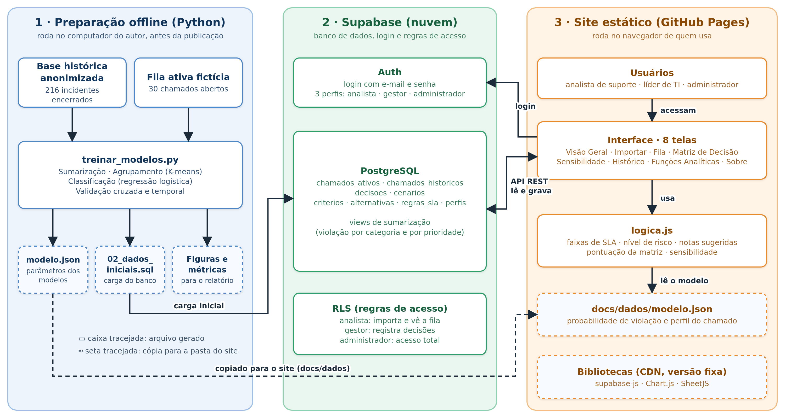
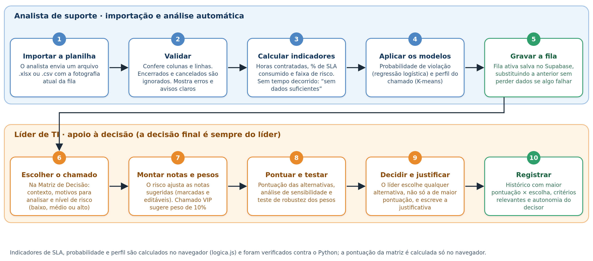

# SAD-SLA — Sistema de Apoio à Decisão para Gerenciamento de Risco de SLA em Chamados de TI

O SAD-SLA ajuda equipes de operações de TI a decidir o que fazer com chamados que correm o risco de violar o prazo de atendimento (SLA). Ele calcula o consumo do SLA, estima o risco, coloca as alternativas de ação lado a lado numa matriz multicritério, deixa o decisor mudar os pesos e simular cenários, e registra a **decisão com a justificativa**. A pontuação apoia a decisão, mas não a determina: o decisor pode escolher qualquer alternativa.

## Detalhes Iniciais

| Perfil | O que pode fazer |
|---|---|
| Analista de suporte | Importa a fila, vê a fila e a matriz de decisão (não registra decisões) |
| Líder de TI (decisor)| Analisa na matriz, registra decisões, simula cenários, vê histórico e funções analíticas |
| Administrador |Acesso a todas as telas |

> Obs.: Os dados são **fictícios ou anonimizados**.

## Como funciona

### Arquitetura


- **Python (offline):** treina os modelos e prepara os dados. Gera `docs/dados/modelo.json` (parâmetros dos modelos) e `database/02_dados_iniciais.sql`.
- **Supabase:** banco PostgreSQL, login (Auth) e regras de acesso por perfil (RLS).
- **Site estático (GitHub Pages):** HTML, CSS e JavaScript puros. Lê e grava no banco por API e calcula SLA, risco, probabilidade e pontuação no navegador.

### Fluxo de dados e de decisão


## Telas e perfis

| Tela | O que faz | Perfis |
|---|---|---|
| Visão Geral | 6 indicadores, gráficos por faixa de SLA, prioridade e categoria, pontos de atenção | todos |
| Importar Dados | Importa planilha (.xlsx ou .csv), valida colunas e linhas, grava a fila | analista, administrador |
| Análise da Fila | Tabela com filtros, busca, ordenação, detalhes e exportação | todos |
| Matriz de Decisão | 4 passos (chamado, alternativas, pesos, matriz) e registro da decisão | todos (só gestor e administrador registram) |
| Análise de Sensibilidade | Altera pesos, compara cenários, teste de robustez, salva cenários | gestor, administrador |
| Histórico de Decisões | Decisões registradas, autonomia do decisor, exportação | gestor, administrador |
| Funções Analíticas | Sumarização, agrupamento e classificação com validação | gestor, administrador |
| Sobre o SAD | Lógica, regras de SLA, faixas e limitações | todos |

## Funções analíticas

| Função | Entrada | Processamento | Resultado decisório |
|---|---|---|---|
| **Sumarização** | 216 incidentes encerrados (base anonimizada) | Contagens e taxas por prioridade e categoria (views no banco) | Mostra onde o risco histórico se concentra; dá contexto a cada chamado |
| **Agrupamento** | Tempo decorrido, atualizações (log) e prioridade, padronizados | K-means; k escolhido pelo silhouette (k = 3, 0,52) | Perfil do chamado: Fluxo regular, Backlog prolongado ou Urgentes em atraso |
| **Classificação** | Prioridade, atualizações (log), categoria e grupo | Regressão logística; alvo: SLA violado | Probabilidade de violação, que eleva o nível de risco quando é 70% ou mais |

Validação da classificação (validação cruzada 5×10): acurácia **0,84**, AUC **0,92**, contra 0,56 da referência. Teste temporal 70/30: acurácia 0,82 (referência 0,66). Sem a variável "atualizações", o AUC cai para 0,78. Detalhes em `documentacao/metricas.json` e `documentacao/figuras/`.

## Modelo de decisão (resumo)

- **Faixas do SLA:** Normal (< 50%), Acompanhamento (50 a 75%), Atenção (75 a 90%), Crítico (90 a 100%), Atrasado (> 100%). Sem tempo decorrido: "Sem dados suficientes" (o sistema não inventa valores).
- **Horas contratadas:** incidente VIP 8 h; P1 4 h, P2 8 h, P3 16 h, P4 24 h; requisição VIP 24 h, standard 72 h.
- **Matriz multicritério:** 5 alternativas × 10 critérios, notas de 1 a 5 (5 = mais favorável); pontuação = soma(nota × peso) ÷ soma dos pesos.
- **Nível de risco** (baixo, médio, alto) a partir do % de SLA e da probabilidade; ele ajusta as notas sugeridas de "Redução do risco" e "Adequação à prioridade". As células ajustadas são marcadas e editáveis. Chamado VIP sugere peso de 10% para "Condição VIP".
- **Pesos iniciais:** obtidos pelo método **Rank Order Centroid (ROC)** (Barron e Barrett, 1996) a partir da ordem de importância definida pela autora: Redução do risco (37,0%), Adequação à prioridade (22,8%), Velocidade (15,6%), Viabilidade (10,9%), Esforço operacional (7,3%), Impacto na fila (4,4%) e Disponibilidade (2,0%). Os critérios de contexto (Condição VIP, Envolvimento da liderança e Dependência profissional) começam em 0%. O decisor pode alterar qualquer peso.
- As notas iniciais e os ajustes por risco são **hipóteses de demonstração**, não efeitos operacionais medidos.

## Estrutura do repositório

```
analytics/        scripts Python (anonimização, fila fictícia, agrupamento, treino e validação)
data/             base anonimizada e fila fictícia (.xlsx)
database/         SQL: 01 esquema, 02 dados (gerado), 03 perfis, 04 keep-alive
docs/             o site (GitHub Pages): index.html, css/, js/, dados/
documentacao/     proposta (PDF), figuras e métricas
.github/workflows/keep-alive.yml   mantém o Supabase gratuito ativo
```

## Como executar

### Opção A: só usar
Abra o endereço do sistema e entre com um dos perfis. - ([Acessar Site](https://palmsb.github.io/sad-sla-2026.2-ufba/))

### Opção B: rodar uma cópia própria
Pré-requisitos: Python 3.10+, Git, conta no [Supabase](https://supabase.com) e no GitHub.

1. **Clonar e instalar**
   ```bash
   git clone https://github.com/palmsb/sad-sla-2026.2-ufba.git
   cd sad-sla-2026.2-ufba
   python -m pip install -r requirements.txt
   ```
2. **(Opcional) Regerar fila, modelos e SQL** — a base anonimizada já está em `data/`:
   ```bash
   python analytics/gerar_fila_ficticia.py
   python analytics/treinar_modelos.py
   ```
3. **Criar o banco no Supabase.** Crie um projeto, abra o **SQL Editor** e rode, nesta ordem, `database/01_esquema.sql` e `database/02_dados_iniciais.sql`.
4. **Criar os 3 usuários** em *Authentication, Users, Add user* (marque *Auto Confirm User*) com os e-mails da tabela de credenciais e senhas à sua escolha. Depois rode `database/03_perfis_usuarios.sql` (deve listar 3 linhas) e `database/04_keepalive.sql`.
5. **Ligar o site ao banco.** Edite `docs/js/config.js` com a *Project URL* e a chave *publishable* (Project Settings). Nunca use a chave `service_role`.
6. **Abrir localmente:**
   ```bash
   python -m http.server 8000 --directory docs
   ```
   Acesse `http://localhost:8000`.
7. **Publicar:** no GitHub, *Settings, Pages, Deploy from a branch, branch `main`, pasta `/docs`*.

### Importar a própria fila
Use a tela **Importar Dados** (há um botão para baixar um modelo de planilha). Colunas aceitas:

| Coluna | Obrigatória | Observação |
|---|---|---|
| Número | sim | Identificador do chamado (use códigos anonimizados) |
| Prioridade | sim | Ex.: `1 - Crítica`, `P2`, `Standard` |
| Estado | sim | Encerrados e cancelados são ignorados |
| TipoChamado | não | `INCIDENTE` ou `REQUISIÇÃO`; se ausente, deduzido pelo prefixo do número |
| GrupoAtribuicao, Analista, Categoria, DataCriacao, UserType, QuantidadeAtualizacoes | não | `SEM-ANALISTA` ou vazio = sem analista; `UserType = VIP` marca VIP |
| TempoDecorridoSegundos | não | Em segundos. Sem ele, o consumo do SLA não é calculado |
| EhVIP | não | Verdadeiro/falso |

## Tecnologias
Python (pandas, scikit-learn, matplotlib, openpyxl) · Supabase (PostgreSQL, Auth, RLS) · HTML, CSS e JavaScript · Chart.js · SheetJS · supabase-js · GitHub Pages e GitHub Actions.
